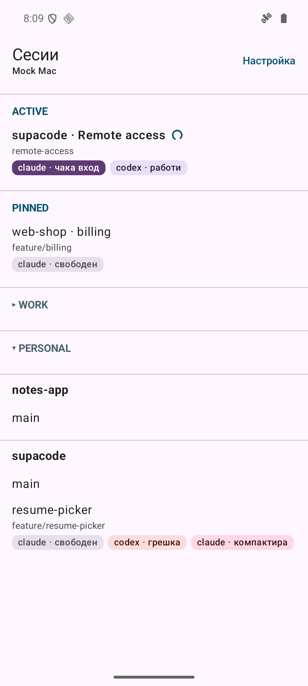
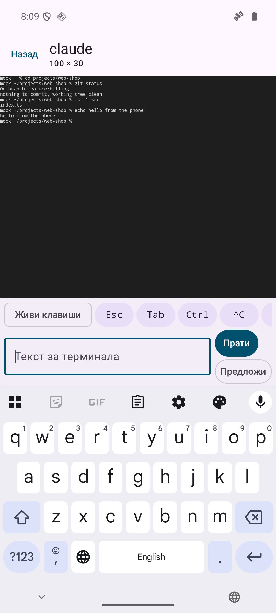
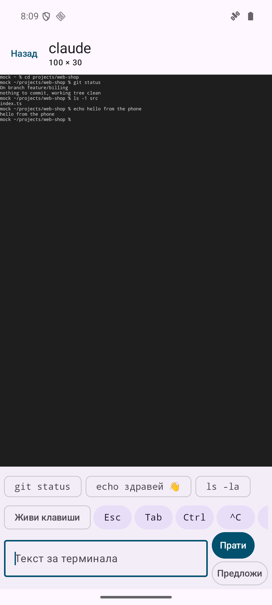

# Supacode Remote

An Android app that turns your phone into a terminal for
[Supacode](https://github.com/supabitapp/supacode), the macOS app that runs coding agents in
parallel Git worktrees. You see the Mac's repositories, worktrees and tabs, open a tab's live
terminal and type into it, and get a notification when an agent is waiting for you.

The app talks only to the remote access feature of a Supacode fork, through a relay you host
yourself on Cloudflare. Nothing listens on the Mac.

The app's UI is in Bulgarian.

| Sessions | Terminal | Suggest |
|---|---|---|
|  |  |  |

The screenshots show the local mock host (`tools/mock-host.mjs`), not a real Mac.

## How it works

```
 Android phone                 Cloudflare                       Mac
+----------------+   WSS   +---------------------+   WSS   +------------------+
| Supacode       | ------> | relay Worker        | <------ | Supacode (fork)  |
| Remote         | /client | + Durable Object    |  /host  | remote access    |
|                | <------ | forwards messages,  | ------> | terminal tabs    |
+----------------+         | reports hostOnline  |         +------------------+
                           +---------------------+
```

- Both sides open an outgoing WebSocket to the relay: the phone to `/client`, the Mac to
  `/host`, each with its own bearer key.
- The relay forwards JSON messages between them and tells the phone whether the Mac is online.
- The Mac owns the terminals. The phone asks for the list, attaches to one tab at a time, gets
  the tab's output and sends keystrokes.

The wire protocol is
[`docs/remote-access-protocol.md`](https://github.com/idachev/supacode/blob/remote-access/docs/remote-access-protocol.md)
in the fork.

## Features

- **Sessions list that mirrors the Supacode sidebar**: Active (an agent or script is running),
  Pinned, your sidebar groups (collapsible), then ungrouped repositories. Each worktree shows its
  branch, custom title and agent badges (`claude · awaiting input`, `codex · busy`, …).
- **Live terminal at the Mac's size**: xterm.js renders the tab at the Mac's columns and rows.
  The phone never resizes the session; it picks a font size that fits the columns and lets you
  pinch-zoom the page.
- **Input bar and key row**: type a line and send it with Enter, or use the keys Esc, Tab,
  sticky Ctrl, ^C, ^D, arrows, PgUp, PgDn, Home, End, Enter, `!` and `/`. PgUp/PgDn go to the
  program (Claude Code scrolls its own history with them); separate buttons scroll the phone's
  own scrollback.
- **Live keys**: a mode where every key from the phone keyboard goes to the terminal at once,
  for y/n prompts, agent menus and shell line editing.
- **Suggest**: asks the Mac for a few things to type next. The Mac runs `claude -p` locally and
  sends back short suggestions. A suggestion only fills the input field; it is never sent on its
  own.
- **Agent-waiting notifications** (off by default): a foreground service keeps the connection
  open in the background and notifies you when an agent in any tab starts waiting for input.
  Tapping the notification opens that terminal.

## Requirements

- The Supacode fork with remote access:
  [idachev/supacode, branch `remote-access`](https://github.com/idachev/supacode/tree/remote-access).
- Your own relay: a Cloudflare Worker from the fork's `remote-relay/` folder. The free plan is
  enough. Setup, keys, rotation and troubleshooting:
  [`docs/remote-access.md`](https://github.com/idachev/supacode/blob/remote-access/docs/remote-access.md).
- To build: JDK 17 and the Android SDK (platform 36). Android 7.0 (API 24) or newer on the
  phone.

## Build and install

```sh
./build-project.sh
```

It runs the unit tests and builds the debug APK. The full Gradle output goes to
`./tmp/claude-logs/build-project-<date>-<time>.log`. The APK is
`app/build/outputs/apk/debug/app-debug.apk`.

Install it on a phone or emulator with USB debugging on:

```sh
adb install -r app/build/outputs/apk/debug/app-debug.apk
```

`scripts/deploy-apk.sh` copies the APK into a folder that syncs to the phone (for example a
Dropbox folder). It reads the folder from `APK_DIR`, set in the environment or in the gitignored
`scripts/deploy-apk.local`:

```sh
APK_DIR="$HOME/Dropbox/<your folder>/supacode-remote"
```

## First run

1. Set up the relay and Supacode as described in the fork's `docs/remote-access.md`. Supacode
   writes the phone's connection key to `~/.config/supacode/remote-client-key.txt` on the Mac.
2. Open the app. On the setup screen ("Настройка"), paste the whole connection key into "Ключ за
   връзка" and tap "Запази и свържи". The key is `<relay host>/<client key>`, for example
   `relay.example.com/abcde-fghij-klmno-pqrst-uvwxy-z2345`. Without a scheme the app uses
   `https://` (`wss://` for the WebSocket).
3. The sessions list appears when the Mac is online. Tap a worktree, then a tab.
4. Optional: turn on "Известия, когато агент чака" for agent-waiting notifications.

## Security model

- **No relay address or keys in the APK or in this repository.** Both come only from the
  connection key you paste on the phone.
- The client key is stored encrypted with a key from the Android Keystore.
- The relay stores only SHA-256 hashes of the host key and the client key (as Worker secrets)
  and compares them in constant time. Keys are 30 random symbols (150 bits).
- The relay limits connection attempts to 20 per IP per minute. Five wrong keys from one IP
  within 10 minutes block that IP for an hour. A relay on your own domain can add a Cloudflare
  WAF rate limiting rule in front of the Worker.
- The relay forwards messages without storing them. Traffic between the phone, the relay and
  the Mac is TLS. The app also accepts an explicit `http://` connection key, but only for the
  local mock below; never use one for a real relay.
- If the phone is lost, rotate the keys (see "Rotate the keys" in the fork's
  `docs/remote-access.md`); the old key stops working at once.

## Local testing without a Mac or Cloudflare

`tools/mock-host.mjs` plays both the relay and the Mac: the same `/client` path, the same
`401` for a wrong key, a sample sidebar, and real local shells as tabs (through `node-pty`).

```sh
cd tools && npm install && node mock-host.mjs
```

It listens on port 8787 with the key `test-key`. In the Android emulator, use the connection key
`http://10.0.2.2:8787/test-key`. A connection key with an explicit `http://` scheme is used as
is; that is why the app allows cleartext traffic.

The mock logs every input as text and hex. Lines typed in a tab trigger test cases:
`mock-resize` (the Mac changes the grid size), `mock-offline` (the Mac goes away for 5 s),
`mock-await` and `mock-busy` (the tab's agent starts or stops waiting, for notifications).

The tabs are real shells in the mock's working directory and `$HOME`, so do not share
screenshots of them without checking what they show.

## Web app for a laptop

`web/` is a local web app that does what the phone app does, for a laptop with a full keyboard
and trackpad. A small Node server on `127.0.0.1` holds the connection key and talks to the relay
and to the Mac's LAN endpoint exactly like the phone (browsers cannot send the `Authorization`
header on a WebSocket or pin a self-signed certificate). The browser page shows the sessions
list and one terminal tab and talks only to that local server.

```sh
web/run.sh               # npm install when needed, then http://localhost:8790 opens
PORT=8791 web/run.sh     # another port; --no-open skips the browser
cd web && npm test       # Node tests, including tests against tools/mock-host.mjs
```

The connection key is stored in `~/.config/supacode-remote-web/config.json` (mode 0600). The
tab keeps the Mac's size and the font fits the window; a new tab starts at the size that fits
the window. Keyboard shortcuts use Ctrl+⌘ (press `?` in the top bar). Design:
[`docs/plans/2026-11-10-web-app-design.md`](docs/plans/2026-11-10-web-app-design.md).

## Project layout

```
app/src/main/kotlin/com/idachev/supacoderemote/
  protocol/    wire messages (kotlinx.serialization), connection key parsing, terminal bytes
  relay/       RelayClient: the WebSocket, reconnects, keepalive, host sessions
  sessions/    the sessions list and its sidebar sections
  terminal/    terminal view model, input bar, key row, live keys
  alerts/      agent-waiting tracker, notifications, background watch service
  settings/    connection settings, encrypted with the Android Keystore
  ui/          Compose screens: setup, sessions, worktree, terminal
app/src/main/assets/terminal/   xterm.js 5.5.0 and the page around it (no CDN at runtime)
app/src/test/                   unit tests
tools/mock-host.mjs             local mock of the relay and the Mac
scripts/deploy-apk.sh           copies the debug APK to a folder that syncs to the phone
docs/CONTEXT.md                 the project's vocabulary (Bulgarian)
CLAUDE.md                       working rules for development (Bulgarian)
```

Stack: Kotlin, Jetpack Compose with Material 3, Navigation 3, OkHttp WebSockets,
kotlinx.serialization. Dependency injection is manual (`AppContainer`).

## Status

A personal project. It is built and used as debug builds only and is not published on Google
Play. Protocol version 1 is still evolving together with the fork's `remote-access` branch.

## License

MIT, see [LICENSE](LICENSE).

Supacode and its remote access relay (in the fork) are a separate project under Supacode's own
license, FSL-1.1-ALv2. This license covers only this Android app.
